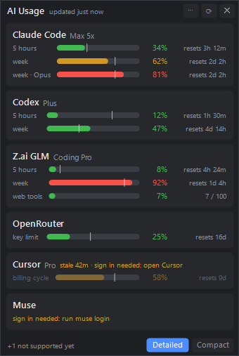
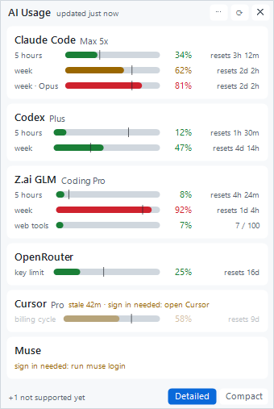

# AI Usage Widget

An always-on-top Windows widget that shows how much of your AI subscription allowances you have
used. Each tool gets a row with its 5-hour, weekly or monthly window, a colour-coded bar and the
reset time, refreshed every few minutes or on demand. The widget reads the login file a tool
already keeps on your PC — or runs the vendor's own CLI — calls that vendor's usage endpoint, and
draws the result in one small borderless window. It is WinForms on .NET Framework 4.8, fully
custom-drawn, a single exe with no installer and nothing else to install.

 

(Sample data, rendered with `bin\AiUsageWidget.Tests.exe --screenshots <folder>`.)

## Supported subscriptions

| Provider | What is shown | Where the login is read from | Status |
|---|---|---|---|
| Claude Code | 5-hour and weekly usage, plus the weekly Opus / Sonnet windows and extra credits when the plan has them | `%USERPROFILE%\.claude\.credentials.json` | unofficial endpoint |
| Codex | ChatGPT plan windows (5-hour / weekly / monthly, as the plan reports), plus code-review limits | `%USERPROFILE%\.codex\auth.json`, or `%CODEX_HOME%\auth.json` when that variable is set | unofficial endpoint |
| Z.ai GLM (coding plan) | 5-hour, weekly and monthly web-tool quotas | `zai-coding-plan` key in the OpenCode `auth.json` (`%USERPROFILE%\.local\share\opencode\auth.json`), else `ZAI_API_KEY`, else `provider.zai.options.apiKey` in `%USERPROFILE%\.zcode\cli\config.json` | your own Z.ai API key |
| OpenRouter | the API key's credit limit and its reset cadence | `OPENROUTER_API_KEY`, or the key you enter in settings (stored encrypted on this PC) | official, documented API |
| Cursor | billing-cycle usage | Cursor's local settings database (`state.vscdb`) | experimental, off by default |
| GitHub Copilot | premium-request and chat quota | the editor's Copilot credential file (`apps.json` / `hosts.json`) | experimental, off by default |
| Muse | 5-hour and weekly usage | none — runs the official `muse usage --json` | official CLI; the populated response shape is unverified |
| Antigravity | 5-hour and weekly usage (highest bucket per window kind) | none — runs the official `agy` CLI | experimental, off by default |
| OpenCode Go | nothing yet | presence in the OpenCode `auth.json` is detected | the vendor has no usage API |

Rows appear automatically for the tools the widget detects on the PC; you can pin or hide each
provider from the tray menu or the settings window. Experimental providers never turn on by
auto-detection — you enable them explicitly. The Claude Code, Codex, Cursor and GitHub Copilot
endpoints are unofficial and may stop working or be disallowed by the vendor — see
[PRIVACY.md](PRIVACY.md).

## Features

- **Two layouts**: Detailed (one card per tool, a bar per window with the percent and reset time)
  and Compact (one line per tool, one column per window kind).
- **Themes**: dark, light, or following Windows; configurable colour thresholds and idle opacity.
- **Pace and forecast**: each bar carries a tick where even spending would be, and a row shows
  "limit in 1h 20m" when your current burn would exhaust the window before it resets.
- **Notifications**: tray notifications when a window crosses a threshold (80 % and 95 % by
  default) or resets.
- **Usage history**: kept locally for 30 days by default, and it is what the forecast reads.
- **A tray icon that mirrors usage**: it fills and changes colour with the worst window, and its
  tooltip lists the worst windows.
- **Tooltips** on the header buttons, each provider row and each usage window.
- Last-known data stays visible (dimmed, "stale") when a fetch fails; an expired login says so
  instead of blanking the row.
- Auto-detection of installed tools, suggestions for tools without usage support, and signed
  auto-updates from GitHub Releases.

## Install

1. Download `AiUsageWidget.exe` from the
   [Releases](https://github.com/SalahSaad93/ai-usage-widget/releases) page.
2. Put it in a folder your user can write to (the auto-updater replaces the exe in place).
3. Run it. The widget appears near the bottom-right of the screen and puts an icon in the tray.
   On first run you choose which subscriptions to show — nothing is fetched before you continue.

Requirements: Windows 10 (1903 or newer) or Windows 11. There is no runtime to install — the exe
uses the .NET Framework 4.8 that ships in Windows.

Windows SmartScreen may warn on first run ("Windows protected your PC") because the exe is not
code-signed. Choose "More info", then "Run anyway".

## Using it

- Drag anywhere on the widget to move it. In Detailed layout the left and right edges resize the
  width; the height always fits the content.
- **Right-click the widget** (or click the ⋯ button in its header) for the menu; the tray icon
  shows the same menu on right-click, and a **single left click on the tray icon toggles** the
  widget. The × button and the Escape key hide it to the tray — they do not quit.
- Refreshes run every 5 minutes, when the PC wakes up, when the network comes back, and on demand
  (the ⟳ button or **Refresh now**).
- Colours: green below the warn threshold, yellow up to the critical threshold, red above
  (defaults 50 % and 70 %).
- Hovering a row or a window shows a tooltip with the details; the mouse wheel scrolls when the
  content is taller than the window.
- A second launch just brings the running widget to the front.

The menu (widget and tray):

- **Refresh now**
- **Layout** — *Detailed* or *Compact*. The chips in the footer switch layouts too.
- **Subscriptions** — every provider with its state (shown and detected, not detected, or hidden);
  click an entry to show or hide it. **Auto-detect** toggles automatic detection.
- **Detected, no usage support yet** — AI tools found on this PC that the widget cannot report on:
  per tool, **Request support…** (opens a pre-filled issue) or **Dismiss**.
- **Always on top**
- **Start with Windows**
- **Settings…** — refresh interval, layout, theme, opacity, thresholds, subscriptions
  (with the OpenRouter key field), notifications, update mode; plus an About tab with buttons to
  open the data folder and the log.
- **Check for updates**, **Install update vX.Y.Z** (when a verified update is waiting), and
  **Set update token…**
- the version line, and **Exit**

## Settings

Settings live in `%LOCALAPPDATA%\AiUsageWidget\settings.json` and can be changed in the settings
window or by hand. A missing or malformed file falls back to defaults, unknown keys survive a
save, and values are clamped to their ranges.

| Key | Default | Meaning |
|---|---|---|
| `refreshMinutes` | `5` | minutes between refreshes; clamped 1–120 |
| `layout` | `"detailed"` | `"detailed"` or `"compact"` |
| `alwaysOnTop` | `true` | keep the widget above other windows |
| `bounds` | first run: bottom-right | `{ "x", "y", "width", "height" }`; a position off every screen falls back to the bottom-right |
| `providers` | `[]` | explicit list of `{ "id": "...", "enabled": true }`; it controls order as well as show/hide |
| `autoDetect` | `true` | show a provider when its tool is detected on this PC |
| `theme` | `"system"` | `"system"`, `"dark"` or `"light"` |
| `opacity` | `100` | idle window opacity; clamped 40–100 |
| `warnPercent` | `50` | bars turn yellow from here; 1–98 |
| `criticalPercent` | `70` | and red above this; must stay above `warnPercent` |
| `notifications.enabled` | `true` | show usage notifications |
| `notifications.thresholds` | `[80, 95]` | percent-used thresholds that trigger a notification |
| `notifications.onReset` | `false` | also notify when a limit resets |
| `historyDays` | `30` | how long usage samples are kept in `history.json`; clamped 1–365 |
| `trayHintShown` | `false` | the one-time "still running in the tray" balloon was shown |
| `consentDone` | `false` | the first-run "choose what to show" window was answered |
| `dismissedSuggestions` | `[]` | tools you dismissed in the menu |
| `announcedSuggestions` | `[]` | suggestion balloons already shown |
| `knownProviders` | `[]` | providers whose appearance was already announced |
| `update.mode` | `"notify"` | `auto` (install when found), `notify` (ask first), `off` |
| `update.repo` | `SalahSaad93/ai-usage-widget` | GitHub Releases `owner/name` to check; empty disables update checks |
| `update.requiresToken` | `false` | send the stored token with update checks (private repository) |

Provider ids: `claude-code`, `codex`, `zai`, `cursor`, `github-copilot`, `openrouter`,
`antigravity`, `opencode-go`, `muse`.

The experimental providers — `antigravity`, `cursor`, `github-copilot` — never turn on by
auto-detection; the only way to show one is an explicit entry such as
`{ "id": "cursor", "enabled": true }`, or its tick in the settings window.

## Updates

At startup and then every 24 hours — plus **Check for updates** in the menu — the widget asks
GitHub Releases (`api.github.com`) for the latest release of `update.repo`. A newer version is
downloaded from the release assets (only `https` URLs on `api.github.com`, `github.com` or
`*.githubusercontent.com`), checked against the release's RSA-signed `latest.json` — the
signature is verified first, then the SHA-256 — and re-verified right before the swap; nothing
unverified is ever run. In `auto` mode the update installs when found; in `notify` mode (the
default) you get a balloon and an **Install update** menu item; `off` disables checks. For a
private repository, set a fine-grained read-only GitHub token with **Set update token…** — it is
stored DPAPI-encrypted in `update-token.bin`, and until then update checks are skipped with an
"updates: token needed" tray note.

## Building from source

    powershell -ExecutionPolicy Bypass -File build.ps1 -Version x.y.z

This needs only Windows: the build uses the C# compiler that ships with Windows
(`%WINDIR%\Microsoft.NET\Framework64\v4.0.30319\csc.exe`, falling back to the 32-bit one when the
64-bit file is missing) and pulls no NuGet packages. The exe lands in `bin\AiUsageWidget.exe`,
after which the build runs the headless self-tests; success prints
`build OK: N selftest checks passed`, and any failure is listed in `bin\selftest.log`. Use
`-OutDir bin\dev` to build into another folder while an installed widget is running. GitHub
Actions runs the same build and tests on every push and pull request.

Publishing a release additionally needs the update-signing key — see the release section of
[docs/DESIGN.md](docs/DESIGN.md).

## Adding a provider

A provider is one class in `src/Providers/` implementing `IUsageProvider`. Keep the response
mapping in a pure `Parse(string json)` that the self-test can run against a saved fixture under
`tests/fixtures/`, and do the I/O in `FetchAsync`. Read the login on each fetch, use it for the
one request, then drop it; never refresh or rewrite another tool's files. The full recipe is
section 15 of [docs/DESIGN.md](docs/DESIGN.md).

## Privacy and safety

The widget reads local login files only to call the usage endpoint of the matching vendor. Tokens
are held in memory for the duration of one request and are never logged, written, or sent anywhere
else. There is no telemetry and no analytics. Which hosts are contacted, what is stored on disk,
and how to remove everything: [PRIVACY.md](PRIVACY.md). The Claude Code, Codex, Cursor and GitHub
Copilot endpoints are unofficial and may stop working or be disallowed by the vendor; this project
is not affiliated with any vendor.

## Licence

[MIT](LICENSE).
